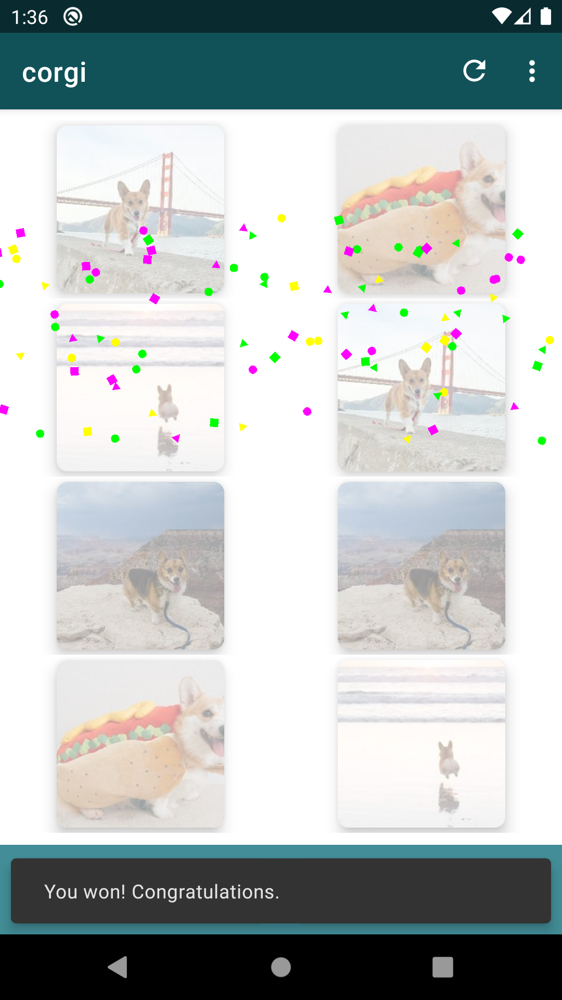
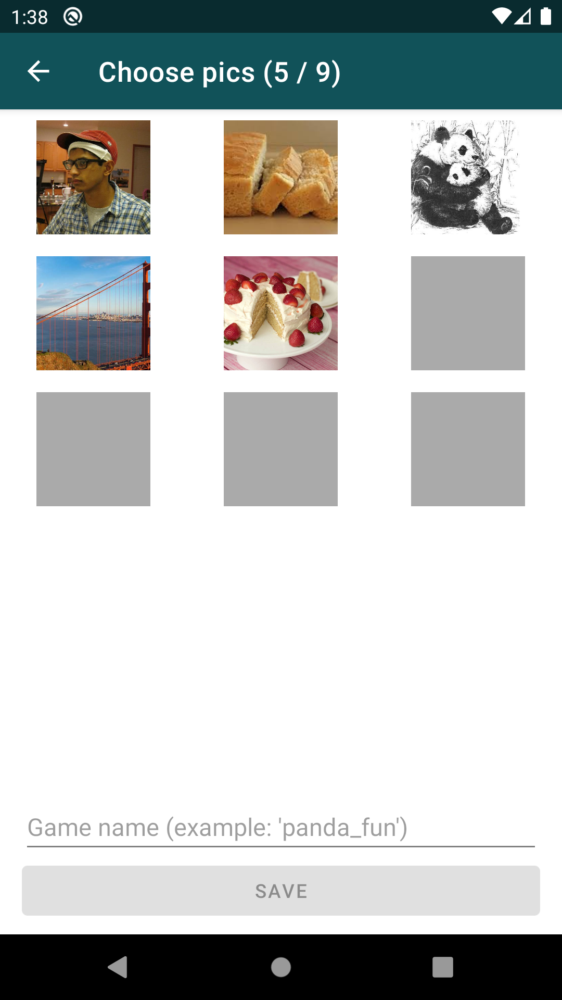

# Meine Speicherkarten — Android Memory Game

A Kotlin/Android memory matching game in which players can match built-in icons or assemble a game from their own photos. The project also includes a shared-board concept with Firebase-backed storage in the source.

  
  

## Features represented in the code

- Flip cards to find matching pairs.
- Create a custom memory board from device images.
- Share/load board content using a game name where the backing services are configured.
- Use visual feedback and win animations.

## Tech stack

Kotlin · Android SDK · Gradle · Firebase Firestore/Storage · Picasso · Confetti.

## Run and configure

Open the project with a compatible Android Studio and Gradle toolchain. Configure your **own** Firebase project and Android application identifiers before testing any online features. Do not commit private service-account keys or production configuration.

The project uses older Android SDK and library versions; upgrades may be needed for modern devices and build tools.

## Attribution and project history

The Android package and original artwork indicate this is based on the open-source **MyMemory** project by [R. Pandey](https://github.com/rpandey1234/MyMemory). This repository is presented as a learning/adaptation exercise, **not as a claim to original authorship of the upstream application**. Consult the repository `LICENSE` and upstream notices before distributing modified builds.

## Next steps

Modernise dependencies, improve accessible controls, isolate Firebase configuration, add UI tests and document which changes were independently implemented.

Repository maintained by [JohnBarsisa](https://github.com/JohnBarsisa).
